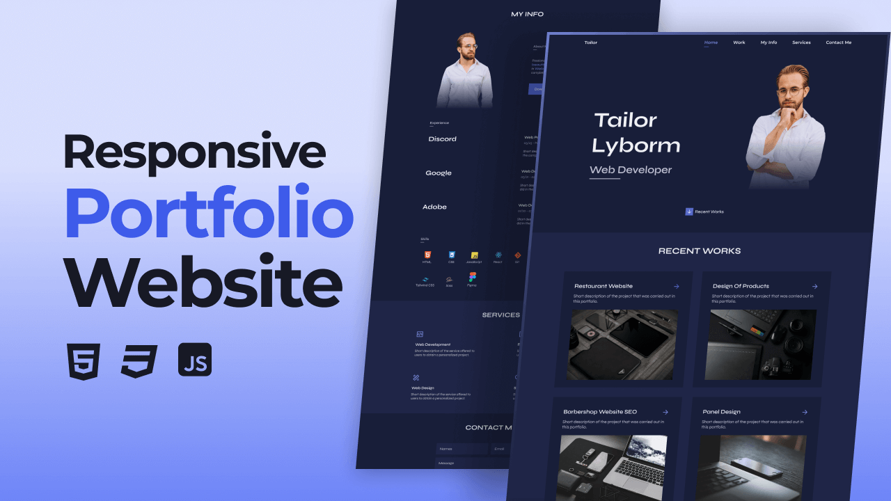

# Virander Kumar — Full-Stack & Frontend Web Developer Portfolio

High-performance, ultra-modern developer portfolio engineered for international clients, startups, and ambitious businesses. Built with clean semantic HTML5, modern CSS3 (glassmorphism, CSS grid, micro-interactions), and responsive vanilla JavaScript.

Live Production URL: [https://my-portfolio-mu-five-38.vercel.app/](https://my-portfolio-mu-five-38.vercel.app/)

---

## 🌟 Key Highlights & Capabilities

- **Global Client Credibility**: Tailored specifically for international founders and companies with timezone alignment (US, UK/EU, Middle East), 100% on-time delivery track record, and 30-day post-launch warranty.
- **Sub-Second Performance**: Optimized for 95+ Google Lighthouse scores, smooth 60fps animations, Core Web Vitals compliance, and responsive asset loading.
- **Production Case Studies**: Real commercial projects including **Allied Luxury Car Rental & Fleet Engine**, **CAF Specialty Coffee Platform**, **Al Ghad HVAC Bahrain**, **Zenith Bistro**, and **Nexus SaaS Analytics Console**.
- **Transparent 5-Step Process**: Discovery & Strategy, UI/UX Wireframing, Agile Sprints (48h staging links), QA & Benchmarks, and Launch Handover.
- **Engagement & Hiring Models**: Transparent options for Fixed-Price Projects, Monthly Retainers, and 48h Speed Sprints.
- **Client Endorsements**: Verified international client reviews with country tags and measurable business outcomes.
- **Interactive FAQ Accordion**: Addresses international coordination, payment terms (USD, EUR, GBP, AED via Stripe/Wise/Wire), code ownership, and NDAs.
- **Live Timezone Clock**: Dynamic real-time clock widget displaying current IST status (GMT+5:30) and availability.
- **Direct Conversion Channels**: Integrated WhatsApp chat, one-click email copy, direct phone calling, and project inquiry form.

---

## 🚀 How to Run Locally

### Option 1: Direct File Launch
Double-click `index.html` or open it in any modern browser.

### Option 2: Local HTTP Server
Double-click `start-server.bat` (or run `.\start-server.ps1` in PowerShell). It serves the site on `http://localhost:8080/`.

---

## 🛠️ Tech Stack

- **Frontend**: Semantic HTML5, Modern CSS3 (Variables, Grid, Flexbox, Glassmorphism, Animations), ES6+ JavaScript
- **Icons & Typography**: Remix Icon (v4.2), Google Fonts (Outfit, Plus Jakarta Sans, JetBrains Mono)
- **Libraries**: ScrollReveal.js, EmailJS
- **Hosting & Deploy**: Vercel CI/CD

---

© 2026 Virander Kumar. All Rights Reserved.
